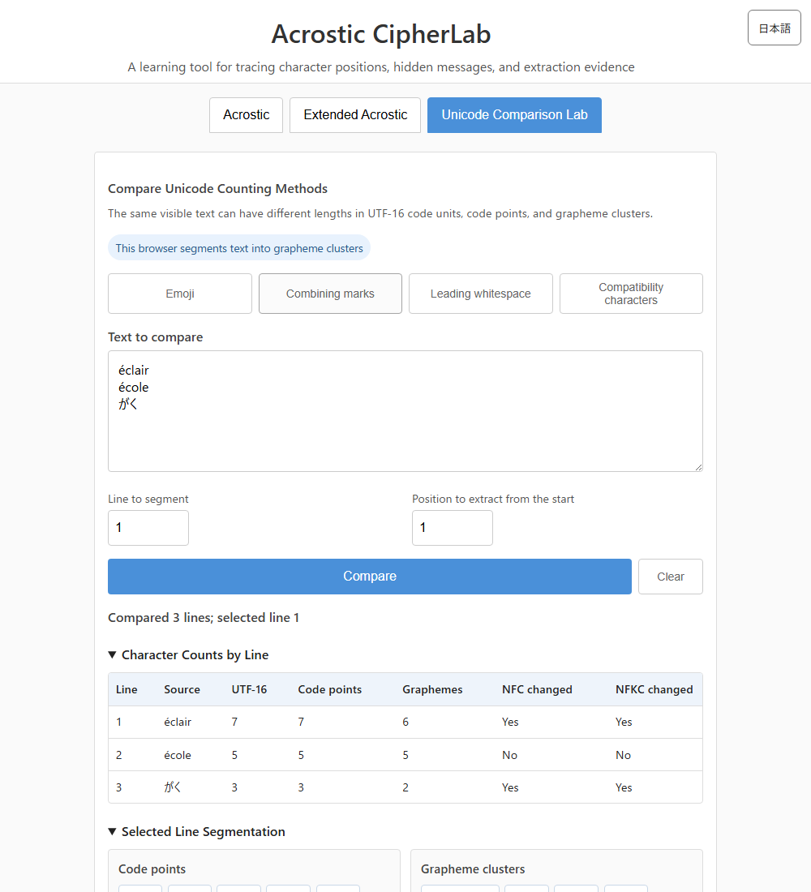

# Acrostic CipherLab - Acrostic and Positional Extraction Tool

[日本語](README.md) | English

[](https://ipusiron.github.io/acrostic-cipherlab/)

**Day103 - Security Tools Built with Generative AI 200**

Acrostic CipherLab extracts characters at specified positions across multiple lines. It shows the source of every selected or excluded character and compares how Unicode counting and normalization affect the same input.

## 🌐 Demo

Try it at [https://ipusiron.github.io/acrostic-cipherlab/](https://ipusiron.github.io/acrostic-cipherlab/).

## 📸 Screenshot



## 🔬 What is an acrostic?

An acrostic hides a word or message at repeated positions, commonly the first character of each line. From a security perspective, it can be examined as a steganographic technique. It is not encryption and does not provide confidentiality by itself.

For example, selecting the first character from four lines beginning with `C`, `O`, `D`, and `E` produces `CODE`.

## ✨ Features

- Extract the first grapheme from every nonempty line.
- Extract the nth grapheme from the start or end.
- Extract the nth grapheme before Western punctuation `, .`, Japanese punctuation `、。`, or both.
- Treat emoji and combining sequences as user-perceived characters when `Intl.Segmenter` is available.
- Optionally ignore leading whitespace.
- Select no normalization, NFC, or NFKC.
- Inspect a trace table containing line number, action, position, selected character, and exclusion reason.
- Distinguish empty lines, whitespace-only lines, short lines, and lines without target punctuation.
- Switch the complete interface between Japanese and English while preserving inputs and results.
- Use the three tabs with pointer, keyboard arrows, Home, and End.
- Compare UTF-16 code units, Unicode code points, and grapheme clusters by line.
- Inspect code-point and grapheme segmentation with `U+XXXX` labels.
- Compare four extraction conditions: raw text with whitespace, raw text without leading whitespace, NFC, and NFKC.
- Load emoji, combining-mark, leading-whitespace, and compatibility-character samples.
- Limit processing to 100,000 UTF-16 code units, 2,000 lines, and position 10,000 to reduce accidental browser stalls.

## 📖 How to use

1. Select **Acrostic**, **Extended Acrostic**, or **Unicode Comparison Lab**.
2. Paste or enter multiple lines.
3. Choose whitespace and normalization behavior.
4. In the extended tab, select a mode, value of n, and punctuation set when applicable.
5. Press **Extract**.
6. Compare the result with the extraction trace.

In the Unicode Comparison Lab, choose a learning sample or enter text and press **Compare**. Once comparison has started, editing the input, selected line, or extraction position updates the results immediately.

## 🎯 Practical experiments

- Enter `😀 alpha` and `🧪 beta`; first-character extraction returns `😀🧪` without splitting surrogate or joiner sequences.
- Enter `AB,tail` and `CD。末尾`, choose both punctuation sets and n=1; the result is `BD`.
- Mix an empty line, a whitespace-only line, and a one-character line with n=2; the trace reports each distinct exclusion reason.
- Compare NFC and no normalization with a decomposed sequence such as `e` plus a combining acute accent.
- In the comparison lab, verify that `😀` is two UTF-16 code units but one code point and one grapheme, while `e` plus a combining acute is two code points but one grapheme.
- Read a rectangular word-search column by selecting the same nth position from every row.
- Audit CTF or puzzle text while retaining the original line numbers used to form a candidate message.

## ⚠️ Scope and limitations

- The tool applies a user-selected positional rule. It does not prove that a hidden message was intentional.
- With `Intl.Segmenter`, positions are counted as grapheme clusters. The fallback counts Unicode code points, which can differ for complex sequences.
- NFKC can change source text, including full-width characters. For evidence preservation or exact source comparison, select no normalization and retain the original separately.
- Comparison results show representation and preprocessing differences; they do not prove a hidden message or authorial intent.
- Processing is limited to 100,000 UTF-16 code units, 2,000 lines, and position 10,000 to reduce accidental browser stalls.
- Extracted text is not proof of successful cryptanalysis and does not provide confidentiality.

## 🔒 Privacy and security

Processing is entirely client-side. Input text is not uploaded or stored. Output is rendered with DOM APIs and `textContent`, not interpreted as HTML. The page uses a restrictive CSP and has no runtime dependencies.

## ✅ Tests

No package installation is required.

```bash
npm test
```

The 21-test suite covers emoji, combining characters, Unicode unit counts, NFC/NFKC comparisons, input limits, CRLF, leading whitespace, Japanese and Western punctuation, excluded-line reasons, document security, ARIA, and primary translations.

## 📁 Project structure

```text
acrostic-cipherlab/
├── index.html
├── style.css
├── script.js
├── acrostic-core.js
├── i18n.js
├── README.md
├── README.en.md
├── package.json
├── test/
└── assets/
```

## 📄 License

Released under the [MIT License](LICENSE).

This tool is part of the [Security Tools Built with Generative AI 200](https://akademeia.info/?page_id=44607) project.
