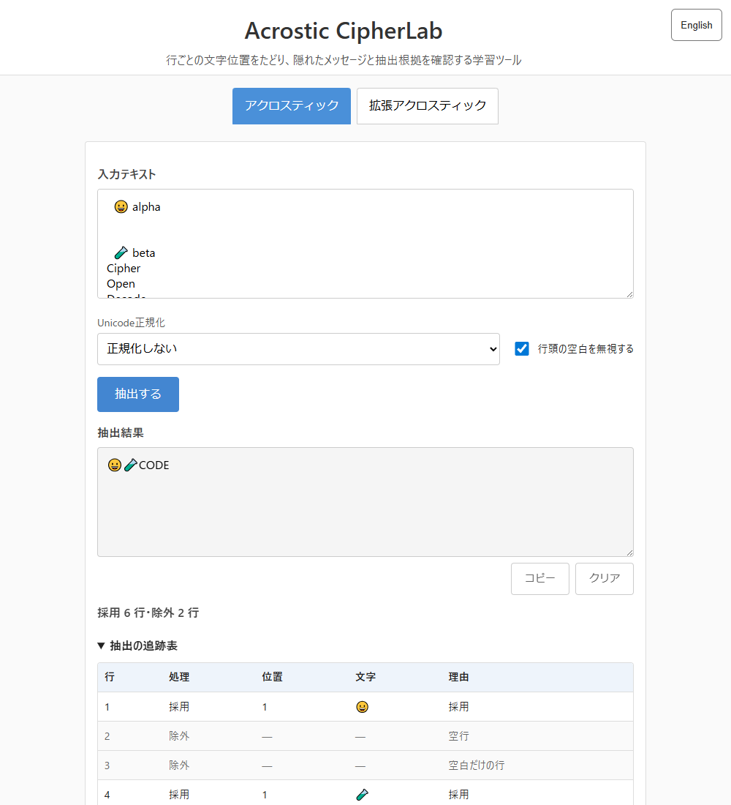

<!--
---
id: day103
slug: acrostic-cipherlab

title: "Acrostic CipherLab"

subtitle_ja: "アクロスティック解読ツール"
subtitle_en: "Laboratory for Acrostic & Positional Extraction"

description_ja: "行頭文字や任意位置を抽出して隠れメッセージを可視化するアクロスティック解読ツール。"
description_en: "An educational tool for extracting acrostics and positional characters to reveal hidden messages."

category_ja:
  - 古典暗号
  - テキスト解析

category_en:
  - Classical Cryptography
  - Text Analysis

difficulty: 1

tags:
  - acrostic
  - cipher
  - text-processing
  - javascript
  - hidden-message

repo_url: "https://github.com/ipusiron/acrostic-cipherlab"
demo_url: "https://ipusiron.github.io/acrostic-cipherlab/"

hub: true
---
-->

# Acrostic CipherLab – アクロスティック解読ツール

日本語 | [English](README.en.md)


[](https://ipusiron.github.io/acrostic-cipherlab/)

**Day103 - 生成AIで作るセキュリティツール200**

Acrostic CipherLabは、複数行テキストから特定位置の文字を抽出し、隠されたメッセージ（アクロスティック）を可視化する教育向けツールです。

行頭文字の抽出だけでなく、行末からの位置指定や記号を基準とした抽出にも対応しており、CTFや暗号解読の学習に活用できます。

---

## 🌐 デモページ

👉 **[https://ipusiron.github.io/acrostic-cipherlab/](https://ipusiron.github.io/acrostic-cipherlab/)**

ブラウザーで直接お試しいただけます。

---

## 📸 スクリーンショット

> 
>
> *CypherのSTEGANOGRAPHY PUZZLE 01を解読*

---

## 🔬 アクロスティックとは

**アクロスティック（Acrostic）** とは、詩や文章の各行の先頭文字（または特定位置の文字）を縦に読むと、別の単語やメッセージが浮かび上がる技法です。
古代ギリシャ・ローマ時代から用いられ、文学的表現や秘密通信の手段として活用されてきました。

セキュリティの観点では、アクロスティックは文字位置にメッセージを隠す**ステガノグラフィー的な技法**として観察できます。文字を暗号鍵で変換する暗号方式ではなく、それだけで機密性を保証するものではありません。

なお、分置式暗号については以下も参考になります。

- [Hidden Message Challenge - 分置式暗号文解読チャレンジツール（Day036）](https://github.com/ipusiron/hidden-message-challenge)

### アクロスティックの例

```
あしたは晴れるかな
いつもの道を歩く
しずかな朝の空気
てんきがいいといいな
```

各行の先頭文字を抽出すると「**あいして**」というメッセージが現れます。

---

## ✨ 機能一覧

本ツールは2つのタブで構成されています。

### アクロスティック（基本機能）

各行の**行頭1文字**を抽出して連結する基本的なアクロスティック解読機能です。絵文字や結合文字は表示上の一文字（書記素クラスタ）として扱います。

- 入力テキストを行ごとに分割
- 各行の先頭1文字を取得して連結
- 空行はスキップ
- 行頭空白を無視するか選択
- Unicode正規化を「なし／NFC／NFKC」から選択
- 元行番号・採用文字・除外理由を追跡表に表示

### 拡張アクロスティック（応用機能）

より柔軟な位置指定による文字抽出が可能です。

| モード | 説明 |
|--------|------|
| 行頭から n 文字目 | 各行の先頭から n 番目の文字を抽出 |
| 行末から前に n 文字目 | 各行の末尾から n 番目の文字を抽出 |
| 句読点前の n 文字目 | 最初に見つかった対象句読点の n 文字前を抽出。`, .`、`、。`、両方から選択 |

空行、空白だけの行、指定位置まで文字がない行、対象句読点がない行は、追跡表でそれぞれ区別されます。

---

## 📖 使い方

1. タブを選択（「アクロスティック」または「拡張アクロスティック」）
2. テキストエリアに複数行のテキストを入力
3. 拡張タブの場合は、抽出モードとnの値を設定
4. 「抽出する」ボタンをクリック
5. 結果が出力欄に表示される

### 使用例

**入力テキスト：**
```
あいうえお
かきくけこ
さしすせそ
```

**基本タブの結果：** `あかさ`（各行の1文字目）

**拡張タブ（行頭から2文字目）の結果：** `いきし`

---

## 🎯 ユースケース

### Unicode境界を含む縦読みの検証

`😀 alpha`と`🧪 beta`の2行を基本抽出すると、UTF-16の途中で分断せず`😀🧪`になります。結合文字、行頭空白、NFC／NFKCを切り替えながら、抽出単位の違いを確認できます。

### 句読点直前のパターン比較

`AB,tail`と`CD。末尾`を入力し、対象句読点を「`, . 、 。`」、nを1にすると`BD`を抽出できます。欧文だけ、日本語だけへ切り替えた差も追跡表で確認できます。

### 欠損行を含む問題の監査

空行、空白だけの行、短すぎる行を混ぜても、採用文字だけでなく各行の除外理由を確認できます。問題文を整形したことで行がずれた場合の発見に利用できます。

### ワードサーチ（縦読み）

本ツールは、ワードサーチパズルで縦方向に隠された単語を探す用途にも利用できます。
「行頭からn文字目」モードでnを指定すれば、グリッドの任意の列を縦に読み取ることが可能です。

```
CATXYZ
OPQRST
DEABCD
EFGHIJ
```

上記で「行頭から1文字目」を抽出すると `CODE` が得られます。

### CTF（Capture The Flag）

CTF競技のステガノグラフィー問題やミスク問題では、テキストに隠されたフラグを探す場面があります。
本ツールを使えば、各行の特定位置から文字を素早く抽出し、隠しメッセージの有無を確認できます。

### 縦読みネタの検出

SNSや掲示板では、一見普通の文章に見せかけて各行の先頭文字で別のメッセージを伝える「縦読み」がしばしば用いられます。
本ツールで行頭文字を抽出すれば、そうした隠しメッセージを簡単に発見できます。

---

## 📁 ディレクトリー構造

```
acrostic-cipherlab/
├── index.html          # メインHTMLファイル
├── acrostic-core.js    # 書記素単位の抽出ロジック
├── i18n.js             # 日本語・英語表示
├── script.js           # 画面制御と追跡表描画
├── style.css           # スタイルシート
├── package.json        # テストコマンド
├── README.md           # 本ドキュメント
├── README.en.md        # English documentation
├── CLAUDE.md           # Claude Code用ガイド
├── LICENSE             # MITライセンス
├── .gitignore          # Git除外設定
├── .nojekyll           # GitHub Pages設定
├── .github/workflows/
│   └── test.yml        # Node.js 22の自動テスト
├── test/
│   ├── acrostic-core.test.js # Unicode境界と抽出規則
│   ├── document.test.js      # 公開設定とHTML
│   └── i18n.test.js          # 主要英訳
└── assets/             # 画像リソース
    └── screenshot.png  # スクリーンショット
```

---

## ⚠️ 判定範囲と限界

- 本ツールは、利用者が指定した位置規則で文字を抽出するツールです。隠しメッセージの存在や作成者の意図を証明しません。
- `Intl.Segmenter`が利用できる環境では書記素クラスタで数え、利用できない環境ではコードポイント単位へフォールバックします。フォントの見た目や自然言語上の「一文字」と常に一致するとは限りません。
- NFKCは全角英数字などを互換分解するため、原文を変化させます。証拠保全や原文照合では「正規化しない」を選び、原文も別途保持してください。
- 抽出結果は暗号解読や機密性の保証ではありません。

---

## 📄 ライセンス

- ソースコードのライセンスは `LICENSE` ファイルを参照してください。

---

## 🛠️ このツールについて

本ツールは、「生成AIで作るセキュリティツール200」プロジェクトの一環として開発されました。
このプロジェクトでは、AIの支援を活用しながら、セキュリティに関連する200個のツールを制作・公開していく取り組みを行っています。

プロジェクトの詳細や他のツールについては、以下のページをご覧ください。

🔗 [https://akademeia.info/?page_id=44607](https://akademeia.info/?page_id=44607)
